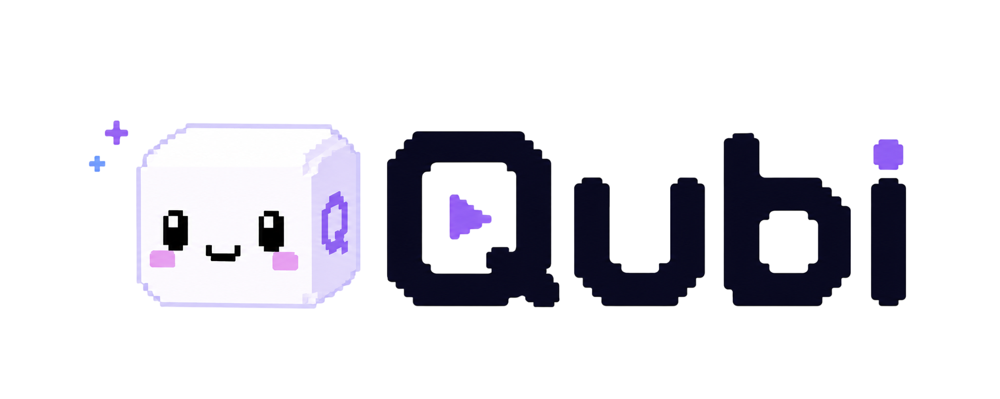
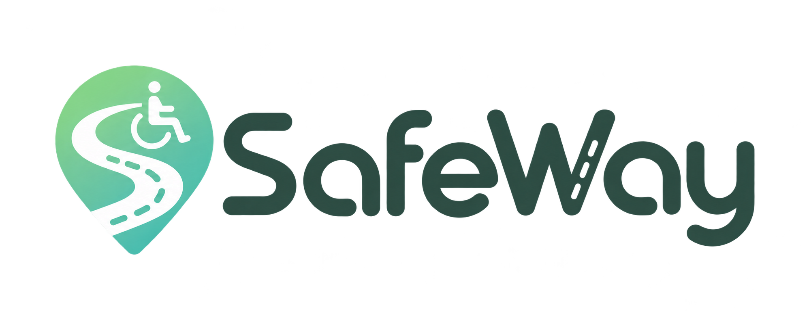

# 안녕하세요, 소연입니다 👋

**Java·Spring Boot로 API를 만들고, React·TypeScript로 사용자 화면을 개발합니다.**

문제가 생기면 화면에서 보이는 증상부터 API 응답과 데이터 처리 과정까지 따라가며 원인을 찾습니다.

## 대표 프로젝트

| MALO | [QUBI](https://chromewebstore.google.com/detail/qubi/ghaajenddgknljmafhnojghejmfmoeba?hl=ko) | [SafeWay](https://github.com/BooGyya/safeway) |
| :---: | :---: | :---: |
|  |  |  |
| 자연어로 투자 전략을 만들고, 확인·승인한 규칙을 실행하는 개인 투자 전략 자동화 서비스. | 한 문장의 아이디어로 HTML 게임을 만들고, 크롬 확장 프로그램에서 오프라인으로 플레이하는 서비스. | 실시간 보행신호와 보행속도를 반영해 교통약자에게 안전한 이동 경로를 안내하는 서비스. |
| 백엔드 · CI/CD | 프론트엔드 · 크롬 확장 프로그램 개발 | 백엔드 |

## 기술 스택

